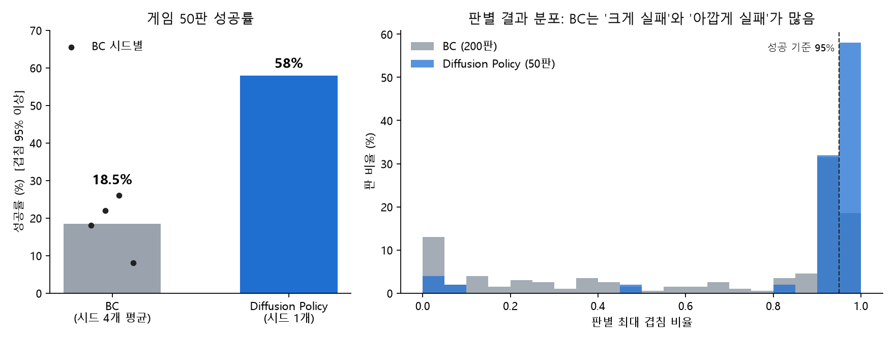
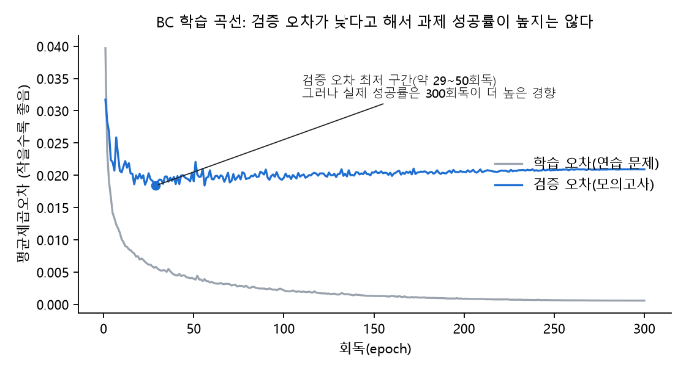
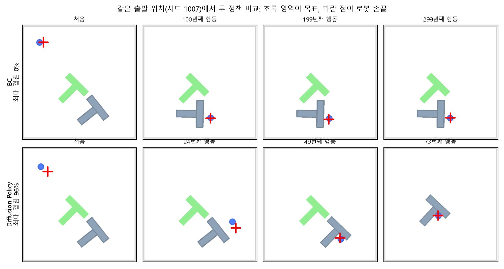

# PushT 모방 학습 미니 프로젝트: Behavior Cloning과 Diffusion Policy 비교

사람의 시연 기록으로 로봇 정책을 학습시키고, 두 가지 모방 학습 방법을 같은 데이터와 같은 평가 조건에서 비교했습니다.

| | Behavior Cloning (시드 4개 평균) | Diffusion Policy (시드 1개) |
|---|---|---|
| 성공률 (목표 겹침 95% 이상) | **18.5%** | **58%** |
| 평균 최대 겹침 | 64.4% | 88.3% |
| 크게 실패한 판 (겹침 50% 미만) | 50판 중 14~19판 | 50판 중 4판 |



## 1. 무엇을, 왜 했나

- **과제(PushT):** 로봇 손끝으로 T자 블록을 밀어 바닥의 목표 자리에 맞추는 2D 시뮬레이션 과제입니다. 블록이 밀리면서 회전하기 때문에 어디를 어떤 순서로 밀지 판단해야 합니다.
- **데이터:** 사람이 직접 조작한 시연 206개(25,650 장면), [lerobot/pusht_keypoints](https://huggingface.co/datasets/lerobot/pusht_keypoints)
- **목적:** 물류, 제조 로봇에서 쓰는 "사람 시연으로 로봇을 가르치는" 방식을 직접 구현하고, 방법에 따라 실제 과제 성공이 어떻게 달라지는지 확인하기 위해서입니다.

## 2. 비교한 두 방법

| | Behavior Cloning (BC) | Diffusion Policy |
|---|---|---|
| 쉬운 설명 | 시연의 "상황과 행동" 짝을 그대로 따라 배운다 | 무작위 동작에서 시작해 잡음을 조금씩 지워 자연스러운 동작 하나를 만든다 |
| 신경망 | MLP(은닉층 3개, 약 56만 파라미터) | 1차원 U-Net(약 420만 파라미터) |
| 예상 약점 | 같은 상황에서 정답이 여러 개면 평균을 배워 어정쩡하게 움직인다 | 동작 하나를 만들 때 계산을 여러 번(100번) 해서 느리다 |

**두 방법에 똑같이 맞춘 조건**
- 데이터 분할: 시연 단위로 학습 186개, 검증 20개
- 입력: 최근 관측 2개(T 블록 키포인트 16 + 손끝 위치 2)
- 출력: 앞으로의 행동 16개를 예측하고 앞의 8개만 실행한 뒤 다시 예측
- 평가: 학습에 쓰지 않은 출발 위치 50개(시드 1000~1049), 판마다 최대 겹침과 성공(95% 이상) 기록

## 3. 직접 한 실험과 해석

### 실험 1. 검증 오차가 가장 낮을 때 멈추면 더 잘할까 (BC 50회독 대 300회독)

- **예상:** 검증 오차가 낮은 50회독이 과적합이 덜해서 더 잘할 것이다.
- **결과:** 예상과 반대였습니다. 시드 0에서 성공률이 50회독 6%, 300회독 18%였습니다.
- **해석:** 검증 오차는 "사람 행동과 평균적으로 얼마나 비슷한가"를 볼 뿐, 블록을 마지막에 정확히 맞추는 미세 동작은 잘 반영하지 못합니다.



### 실험 2. 그 차이가 우연은 아닐까 (학습 시드 반복)

| 설정 | 시드별 성공률 | 평균 성공률 | 평균 최대 겹침 |
|---|---|---|---|
| BC 300회독 | 18%, 22%, 26%, 8% | 18.5% | 64.4% |
| BC 50회독 | 6%, 16%, 12% | 11.3% | 59.9% |

- 처음 시드 3개에서는 300회독이 세 번 모두 성공률이 높았습니다.
- 시드 4를 추가하자 성공률이 8%로 가장 낮았습니다. 평균 겹침은 오히려 68.7%로 가장 높았고, 85~95% 사이에서 아깝게 실패한 판이 25판이었습니다.
- **고친 결론:** 300회독이 평균적으로 나은 경향은 있지만 두 설정의 범위가 겹쳐 확정할 수 없습니다. "목표 근처까지 미는 능력"과 "마지막에 정확히 맞추는 능력"을 따로 봐야 합니다.

### 실험 3. Diffusion Policy는 BC의 약점을 줄이는가

- 크게 실패한 판(50% 미만)이 BC 14~19판에서 Diffusion Policy 4판으로 줄었습니다. "정답이 여러 개일 때 평균을 배워 어정쩡하게 움직인다"는 BC의 약점을 Diffusion Policy가 줄인다는 예상과 맞습니다.
- 겹침 중앙값도 95.1%로, 절반 이상의 판에서 블록을 목표에 거의 맞췄습니다.



## 4. 한계 (정직하게 밝혀 둘 점)

- **Diffusion Policy는 시드 1개 결과입니다.** BC에서 시드에 따라 성공률이 8~26%로 흔들렸으므로 반복 실험이 필요합니다. 다만 BC 최고 시드(26%)와의 차이도 커서 결론이 뒤집힐 가능성은 낮다고 봅니다.
- **조건이 완전히 같지 않습니다.** Diffusion Policy가 모델이 더 크고(약 420만 대 56만 파라미터) 더 오래 학습했습니다(500회독 대 300회독). 따라서 차이가 전부 방법 덕분이라고 단정할 수 없습니다.
- **평가 판 수가 50판입니다.** 1판이 2%p라, 판 수를 늘려야 작은 차이를 구별할 수 있습니다.
- **2D 시뮬레이션입니다.** 실제 로봇의 접촉, 지연, 센서 잡음은 포함하지 않았습니다.
- **속도:** Diffusion Policy는 행동을 한 번 만들 때 계산을 100번 반복해서 BC보다 느립니다. 실제 로봇의 반응 속도를 생각하면 계산 횟수를 줄이는 실험이 다음 과제입니다.

## 5. 실행 방법

```powershell
python -m venv venv
.\venv\Scripts\pip install torch --index-url https://download.pytorch.org/whl/cu124
.\venv\Scripts\pip install gym-pusht huggingface_hub pandas pyarrow matplotlib tqdm
.\venv\Scripts\python 01_download_data.py      # 시연 데이터 받기
.\venv\Scripts\python 03_train_bc.py           # BC 학습과 평가(약 2분)
.\venv\Scripts\python 04_repeat_bc.py          # BC 반복 실험
.\venv\Scripts\python 05_train_diffusion.py    # Diffusion Policy 학습과 평가(RTX 3050 노트북 약 50분)
.\venv\Scripts\python 06_make_figures.py       # 결과 그림
```

| 파일 | 내용 |
|---|---|
| `common.py` | 데이터 분할, 정규화, 시뮬레이션 평가(두 방법 공통) |
| `03_train_bc.py` | BC 모델, 학습, 평가 |
| `04_repeat_bc.py` | 학습 횟수, 시드 반복 실험 |
| `05_train_diffusion.py` | Diffusion Policy 모델(1차원 U-Net), 잡음 일정, 학습, 샘플링, 평가 |
| `06_make_figures.py` | 결과 그림 3장 |
| `results/*.json` | 판별 겹침 비율, 학습 곡선 |

## 6. 만든 과정

- 2026년 11월 개인 미니 프로젝트입니다.
- 코드 초안 작성에 생성형 AI(Claude)를 활용했습니다.
- 학습 횟수와 시드를 바꾼 실험 실행, 예상과 결과 비교, 결론 수정은 직접 했습니다.

## 참고

- Chi et al., *Diffusion Policy: Visuomotor Policy Learning via Action Diffusion*, RSS 2023
- [gym-pusht](https://github.com/huggingface/gym-pusht), [LeRobot](https://github.com/huggingface/lerobot)
